  

# 🤖 Awesome AI Agent Capabilities & Resource Orchestration

  
  
  
  
  

---

## 🌟 Overview & Mission

> **The definitive directory of platforms and frameworks for AI Agent Skill Synthesis, Model Context Protocol (MCP) tool gateways, OpenTelemetry distributed tracing, LLM resource orchestration, and autonomous trajectory evaluations.**

Whether you are building autonomous coding agents, multi-agent enterprise swarms, or low-latency tool-routing proxies, this repository tracks state-of-the-art tools to:
- 🔄 **Synthesize & Distill Skills**: Automatically extract verified agent skills and executable workflows from heterogeneous documentation, codebases, and API specs (e.g. `microsoft/resource2skill`).
- 🔌 **Standardize Tool Protocols**: Connect agents to live databases, terminal environments, and SaaS apps via the **Model Context Protocol (MCP)** standard.
- 🚦 **Orchestrate LLM Resources**: Balance budgets, manage multi-model fallbacks, cache semantic queries, and enforce rate limits across 100+ LLMs.
- 🔭 **Trace & Observe Trajectories**: Capture recursive agent thoughts, tool invocation trees, token expenditure, and latency with native OpenTelemetry instrumentation.
- 🧪 **Evaluate Capabilities**: Continuously benchmark tool-calling accuracy, hallucination rates, and task completion in CI/CD pipelines.

---

## 📑 Table of Contents

- [📊 Sector Overview & Market Dynamics](#-sector-overview--market-dynamics)
- [☁️ SaaS & Hosted Platforms](#️-saas--hosted-platforms)
- [⚡ Open-Source GitHub Projects (Ranked by Stars)](#-open-source-github-projects-ranked-by-stars)
- [📈 Star History](#-star-history)
- [💖 Support & Community](#-support--community)
- [🤝 How to Contribute](#-how-to-contribute)
- [⚠️ Disclaimer](#️-disclaimer)

---

## 📊 Sector Overview & Market Dynamics

The global AI observability and agent orchestration market is estimated at approximately **$2.5B–$4B**, expanding at an aggressive CAGR of over 22–25% toward an expected $15B+ by the early 2030s. The sector is currently **moderately fragmented** between agile open-source-first startups and agent-native tracing tools, but is experiencing rapid consolidation as enterprise APM incumbents (Datadog, Dynatrace, ServiceNow) and hyperscalers acquire or natively assimilate agent evaluation and MCP orchestration capabilities.

---

## ☁️ SaaS & Hosted Platforms

| Platform | Company Valuation / Scale | Starting Pricing | Free Tier / Trial Limits | Description |
| :--- | :--- | :--- | :--- | :--- |
| **[LangSmith (LangChain)](https://langchain.com)** | ~$3.0B valuation ($460M raised) | $39 / seat / month (Plus tier; additional base traces billed at $0.005/trace) | Free forever (Developer plan): 1 seat, up to 5,000 base traces/month, 1 workspace, 14-day data retention | All-in-one developer platform for debugging, testing, evaluating, and monitoring LLM chains and complex multi-agent execution graphs at enterprise scale. |
| **[Braintrust](https://braintrust.dev)** | ~$800M valuation ($121M raised) | $249 / month (Pro tier base fee + usage) | Free forever (Starter tier): Up to 5 users, capped at ~1,000 spans/week, model playground credits, unlimited playgrounds & datasets | End-to-end enterprise AI evaluation, prompt playground, and observability suite designed to score agent capabilities and prevent regressions across releases. |
| **[Arize AX / Arize Phoenix Cloud](https://arize.com)** | ~$500M–$1B valuation ($130M+ raised) | $50 / month (Arize AX Pro tier) | Free forever (AX Cloud): Up to 25,000 spans/month, 1 GB ingestion limit, 15-day data retention (Phoenix OSS self-hosted is 100% free with unlimited spans) | Enterprise AI observability and LLM evaluation platform delivering deep span-level tracing, drift detection, and root-cause analysis for agentic pipelines. |
| **[Traceloop](https://traceloop.com)** | ~$60M–$80M acquisition (Acquired by ServiceNow; $6.6M raised prior) | Custom enterprise quote / AWS Marketplace contracts | Free forever (Cloud Starter): Up to 50,000 spans/month, unlimited seats, full feature access (OpenLLMetry SDK is open-source Apache 2.0) | Hosted OpenTelemetry-native LLM observability and reliability platform built on OpenLLMetry for real-time agent tracing and hallucination guardrails. |
| **[Helicone](https://helicone.ai)** | ~$25M valuation (Acquired by Mintlify; $5M raised prior) | $79 / month (Pro tier; includes 10k requests, extra usage billed incrementally) | Free forever (Hobby tier): 1 seat, 1 organization, up to 10,000 requests/month, 1 GB storage, 1-month retention | Proxy-based LLM observability and AI gateway platform offering request caching, rate limiting, cost tracking, and multi-provider resource routing. |
| **[HoneyHive](https://honeyhive.ai)** | ~$15M–$25M est. valuation ($7.4M raised) | Custom enterprise quote (Usage-based based on logged telemetry) | Free forever (Developer tier): Up to 5 users, 10,000 events/month, 1,000 RPM, 30-day data retention | AI observability and evaluation platform built for compounding agent reliability through curated production datasets, human feedback loops, and CI/CD evals. |
| **[Langfuse Cloud](https://langfuse.com)** | ~$15M–$20M est. valuation ($4.5M raised) | $29 / month (Core tier; includes 100,000 units/month, extra units at $8/100k) | Free forever (Hobby tier): 2 users, up to 50,000 units (observations/events)/month, 30-day data retention (OSS self-hostable 100% free) | Managed cloud deployment of the open-source LLM engineering platform providing trace analytics, prompt management, datasets, and online agent evaluations. |
| **[AgentOps](https://agentops.ai)** | ~$10M–$15M est. valuation ($2.6M raised) | $40 / month (Pro tier; includes base event volume + pay-as-you-go scaling) | Free forever (Basic tier): Up to 5,000 events/month, basic replay and tracing features | Dedicated agent monitoring and replay platform tracking tool calls, recursive thoughts, LLM costs, session replays, and failure modes across agent frameworks. |
| **[Lunary](https://lunary.ai)** | Early-stage / Bootstrapped (<$5M) | $20 / user / month (Team tier; includes 50,000 events/month and 300 AI Playground queries) | Free forever (Free plan): Up to 1,000 events/month, 1 user seat, 30-day history (Full OSS self-hosted is completely free) | Production LLM observability, prompt management, and user analytics platform tailored for B2B AI applications and multi-step agent workflows. |
| **[OpenLIT Cloud](https://openlit.io)** | Early-stage / Open-Core (<$5M) | Contact for Cloud quote / Enterprise contract | Free forever (OSS Core): Apache 2.0 self-hostable via Docker/Kubernetes with 0 trace fees and no seat limits | Managed OpenTelemetry-native observability and GPU/LLM resource monitoring platform tracking token consumption, vector DB latency, and agent traces. |

---

## ⚡ Open-Source GitHub Projects (Ranked by Stars)

Every major open-source repository for self-hosted LLM observability, skill extraction, Model Context Protocol (MCP) servers, API gateways, guardrails, and agent evaluation, sorted strictly in descending order of GitHub stars:

1. **[modelcontextprotocol/servers](https://github.com/modelcontextprotocol/servers)**   
   Reference implementations and standard servers for the **Model Context Protocol (MCP)**, connecting AI agents to real-world context, databases, developer tools, and file systems.

2. **[mem0ai/mem0](https://github.com/mem0ai/mem0)**   
   The intelligent memory layer for AI agents. Provides personalized, persistent context across sessions, enabling agents to remember user preferences, execution histories, and domain facts.

3. **[BerriAI/litellm](https://github.com/BerriAI/litellm)**   
   Lightweight, high-performance AI Gateway with a Rust core and Python SDK. Call 100+ LLMs in OpenAI format with load balancing, spend tracking, fallback routing, and guardrails.

4. **[langfuse/langfuse](https://github.com/langfuse/langfuse)**   
   Full-stack open-source LLM engineering and observability platform. OpenTelemetry-native agent tracing, prompt versioning, playground, evals, and fine-grained cost analytics.

5. **[songquanpeng/one-api](https://github.com/songquanpeng/one-api)**   
   Unified multi-tenant API distribution and resource management gateway supporting OpenAI, Azure, Anthropic Claude, Gemini, DeepSeek, and dozens of upstream LLM providers.

6. **[getzep/graphiti](https://github.com/getzep/graphiti)**   
   Framework for constructing real-time, temporally aware dynamic knowledge graphs from unstructured agent interactions and tool invocations.

7. **[promptfoo/promptfoo](https://github.com/promptfoo/promptfoo)**   
   Battle-tested CLI and CI/CD testing suite for red-teaming, prompt evaluation, security probing, and evaluating multi-step agent tool calling. Used by OpenAI and Anthropic.

8. **[comet-ml/opik](https://github.com/comet-ml/opik)**   
   Enterprise-grade open-source LLM evaluation, agent tracing, and dataset curation framework featuring automated scoring pipelines and production analytics dashboards.

9. **[confident-ai/deepeval](https://github.com/confident-ai/deepeval)**   
   Production-ready evaluation harness structured like Pytest for LLM applications. Measures tool correctness, hallucination, answer relevancy, and agent trajectory completion.

10. **[explodinggradients/ragas](https://github.com/explodinggradients/ragas)**   
    Comprehensive framework for evaluating Retrieval-Augmented Generation (RAG) and tool-augmented agent workflows with synthetic test dataset generators.

11. **[Portkey-AI/gateway](https://github.com/Portkey-AI/gateway)**   
    Blazing-fast AI Gateway with built-in guardrails, load balancing, automated retry strategies, and request caching routing across 1,600+ models.

12. **[Arize-ai/phoenix](https://github.com/Arize-ai/phoenix)**   
    AI observability, evaluation, and OpenTelemetry trace visualizer. Diagnoses agent tool loops, embedding drifts, RAG failure modes, and reasoning steps in notebooks or servers.

13. **[tensorzero/tensorzero](https://github.com/tensorzero/tensorzero)**   
    Industrial-grade open-source LLMOps infrastructure written in Rust, unifying model gateway proxies, observability, evaluation, dynamic optimization, and experimentation.

14. **[traceloop/openllmetry](https://github.com/traceloop/openllmetry)**   
    OpenTelemetry extensions for LLMs and agent frameworks (LangChain, LlamaIndex, AutoGen, CrewAI). Automatically captures non-intrusive traces and spans across runs.

15. **[NVIDIA/NeMo-Guardrails](https://github.com/NVIDIA/NeMo-Guardrails)**   
    Open-source toolkit by NVIDIA for programming safety rails, domain constraints, output validation, and secure execution limits into LLM-powered applications.

16. **[Helicone/helicone](https://github.com/Helicone/helicone)**   
    Lightweight, self-hostable open-source LLM observability proxy and caching gateway. Drop in a single line of code to track latency, token usage, and user sessions.

17. **[lm-sys/RouteLLM](https://github.com/lm-sys/RouteLLM)**   
    LMSYS framework for training, evaluating, and serving cost-optimizing LLM routers. Dynamically routes queries between expensive frontier models and lighter SLMs with minimal degradation.

18. **[Agenta-AI/agenta](https://github.com/Agenta-AI/agenta)**   
    Collaborative LLMOps workspace to rapidly prompt, test, evaluate, and deploy production AI agents and custom automation workflows.

19. **[truera/trulens](https://github.com/truera/trulens)**   
    Software library providing rigorous feedback functions, evaluation triads, and guardrail metrics to systematically monitor and benchmark LLM and multi-agent systems.

20. **[UKGovernmentBEIS/inspect_ai](https://github.com/UKGovernmentBEIS/inspect_ai)**   
    Evaluation framework developed by the UK AI Safety Institute (AISI) for measuring frontier agent capabilities, sandboxed execution, tool reliability, and safety risks.

21. **[protectai/llm-guard](https://github.com/protectai/llm-guard)**   
    Comprehensive security toolkit and scanner designed to prevent prompt injections, toxicity, data leakage, and unauthorized tool invocation in agentic systems.

22. **[openlit/openlit](https://github.com/openlit/openlit)**   
    OpenTelemetry-native AI engineering platform providing zero-code auto-instrumentation for 50+ LLMs, vector databases, GPU usage, and multi-agent execution trees.

23. **[microsoft/Resource2Skill](https://github.com/microsoft/Resource2Skill)**   
    Microsoft Research framework for automatically distilling human documentation, multimodal manuals, code repositories, and APIs into executable, verifiable AI agent skill packages.

---

## 📈 Star History

---

## 💖 Support & Community

Thank you for exploring **Awesome AI Agent Capabilities & Resource Orchestration**! If you find this curated directory valuable for your research, team, or production architecture, please consider supporting the project:

- ⭐ **Star this repository** on GitHub to help more builders and engineers discover it.
- 🍴 **Fork the repo** to curate your own internal agent capability stack.
- 📢 **Share with your network** on X/Twitter, LinkedIn, Discord, and AI communities.
- ☕ **Buy a coffee & sponsor ongoing maintenance** via the [GitHub Sponsor Dashboard](https://github.com/sponsors/ishandutta2007).

Your sponsorship helps keep this knowledge base actively updated, verified, and benchmarked!

---

## 🤝 How to Contribute

Contributions are welcome and appreciated! To maintain the highest quality standards:

1. 🍴 **Fork the repository**.
2. 📝 **Add or update an entry** in `README.md`:
   - Follow the established formatting (include links, star badges for open-source repos, and factual descriptions).
   - Ensure open-source projects are placed in correct star-ranked order.
   - For SaaS products, provide verifiable company scale, exact starting pricing, and concrete free-tier/trial limits.
3. 🚀 **Submit a Pull Request** with a descriptive summary of your addition or modification.

---

## ⚠️ Disclaimer

- This is a **community-curated** list — not exhaustive and not an endorsement of any vendor or methodology.
- Automated skill synthesis tools (such as `resource2skill`) and dynamic MCP tool servers can introduce prompt-injection or unintended code-execution risks if ingesting untrusted external repositories or documentation. Always run agent tool execution within sandboxed environments.
